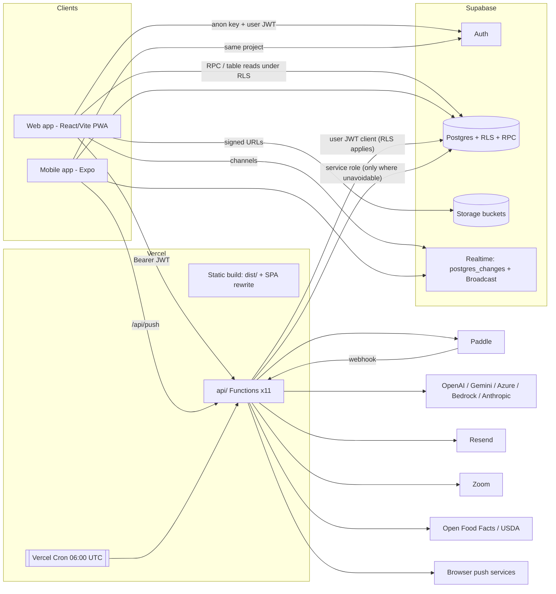
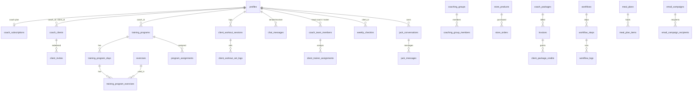

# ApexFit — Architecture Reference

Single reference for how the ApexFit platform is built: stack, folders, features (route → UI → service → database), database/security model, serverless API, configuration and current status.

- **Verified against the repository on 2026-11-27** (`src/`, `api/`, `supabase/migrations/`, `data/`, `scripts/`, `apps/mobile/`, `tests/`, `vercel.json`, `package.json`). Nothing here comes from memory; counts below were taken from the files.
- **No secrets.** Only variable *names* appear in this document, never values. Real keys live in Vercel project settings, `.env.local` (git-ignored) or the Supabase dashboard.
- Companion docs: [README.md](README.md) (setup and per-feature notes), [apps/mobile/README.md](apps/mobile/README.md) (native app), [data/README.md](data/README.md) (exercise catalog source/licence), [.env.example](.env.example) (variable template).

## Contents

1. [Overview and tech stack](#1-overview-and-tech-stack)
2. [Directory and file map](#2-directory-and-file-map)
3. [Feature catalog](#3-feature-catalog)
4. [Database, RLS and storage](#4-database-rls-and-storage)
5. [Server functions (`api/`)](#5-server-functions-api)
6. [Environment variables, scripts and tests](#6-environment-variables-scripts-and-tests)
7. [Current status and pending setup](#7-current-status-and-pending-setup)
8. [Appendix: migrations and conventions](#8-appendix-migrations-and-conventions)

---

## 1. Overview and tech stack

ApexFit is a coaching workspace for fitness coaches and their clients: programs, nutrition, habits, weekly check-ins, chat (text and voice), live video sessions, packages/invoices, a program store, a community with points, automated workflows, and **Jack**, an AI assistant that can read and act inside the app with the user's own permissions.

### 1.1 Stack

| Layer | Technology | Where |
| --- | --- | --- |
| Web app | React 19, React Router 7 (path routing, lazy-loaded pages), Vite 7 | `src/`, `index.html`, `vite.config.js` |
| Styling | Hand-written CSS on design tokens (no UI framework). Every colour is a CSS variable, so one stylesheet serves three appearances | `src/styles/tokens.css`, `src/styles/app.css` |
| Appearance | **Dark / Light / System.** The choice lives in `localStorage` (`apexfit.theme`, default dark); `ThemeProvider` resolves *system* through `prefers-color-scheme` and writes `<html data-theme="dark｜light" data-theme-mode>`; a tiny script in `index.html` sets it before the first paint | `src/contexts/ThemeContext.jsx`, `src/services/themeUtils.js`, `src/components/ThemeToggle.jsx` |
| i18n | 5 locales: `en`, `ar`, `de`, `fr`, `es`; Arabic switches the layout to RTL | `src/i18n/`, `src/contexts/LocaleContext.jsx` |
| Backend (data/auth) | Supabase: PostgreSQL + RLS, Auth (email/password + Google), Storage, Realtime | `supabase/` |
| Serverless | Vercel Functions (Node, ES modules) — 11 endpoints + shared `_lib` | `api/`, `vercel.json` |
| Native app | Expo 58 / React Native 0.88, expo-router, same Supabase project | `apps/mobile/` |
| PWA / push | Service worker + Web Push (VAPID, `web-push`) | `public/sw.js`, `public/manifest.webmanifest`, `api/push.js` |
| In-app notifications | `notifications` table filled by database triggers, read through RPCs; bell with unread count in the top bar, Realtime + 45 s polling | `src/components/NotificationBell.jsx`, `src/hooks/useNotifications.js`, `supabase/migrations/…004300_notifications.sql` |
| Payments (platform) | Paddle Billing (Merchant of Record) for the $39/month coach plan | `api/paddle*.js`, `api/_lib/paddle.js` |
| Payments (coach ↔ client) | Direct: bank transfer / custom method, confirmed manually by the coach. No payment gateway, no Stripe | `invoicing*`, `store*` |
| AI | OpenAI, Google Gemini, Azure AI Foundry, Amazon Bedrock (Converse + SigV4, no AWS SDK), optional Anthropic for the coach work screens | `api/_lib/jack*.js`, `anthropicModel.js` |
| Email | Resend (campaigns), signed one-click unsubscribe | `api/send-campaign.js`, `api/unsubscribe.js` |
| Video calls | Native WebRTC mesh over Supabase Realtime Broadcast (default); Zoom/Meet/custom links optional | `src/services/webrtcRoom.js`, `roomSignaling.js` |
| Tests | `node --test` (no framework) + `@electric-sql/pglite` (real Postgres in-process running `supabase/manual-setup.sql`) | `tests/` |

Runtime dependencies (web): `@supabase/supabase-js`, `react`, `react-dom`, `react-router-dom`, `web-push`. Dev: `vite`, `@vitejs/plugin-react`, `@electric-sql/pglite`.

### 1.2 System diagram



### 1.3 Core design rules

1. **The database is the security boundary.** Browser route guards are UX only. Every table has RLS enabled; sensitive writes go through `security definer` functions (RPCs) that re-check the caller's role, ownership and plan.
2. **Server functions act as the user.** Almost every `api/` function builds a Supabase client from the caller's JWT (`authenticate()` in `api/_lib/auth.js`), so RLS still decides what is readable. The service-role client (`adminClient()`) is used only for work no user may do (billing events, AI settings storage, push subscriptions lookup, unsubscribe, cron).
3. **Server time and server rules.** Trial dates, plan state, amounts, currencies, points and statuses are computed in Postgres, never trusted from the browser.
4. **Pure logic is separated and tested.** Each feature has `*Service.js` (I/O with Supabase/`fetch`) and `*Utils.js` (pure validation/formatting/calculation) so most behavior is unit-testable without a browser.

### 1.4 Roles and access states

`get_my_access_status()` (Postgres RPC, latest definition in migration `20261115002300`) returns the account's role and plan. `src/routes.js#roleOf()` maps it to one of three UI roles:

| UI role | `profiles.role` | `access_state` | Meaning |
| --- | --- | --- | --- |
| `coach` | `coach` | `trialing` / `active` / `expired` | Head coach. 14-day trial from first sign-in (`trial_ends_at = trial_started_at + 336h`; legacy 72h windows still allowed by the CHECK constraint), then needs an active Paddle subscription. `past_due` keeps access until `current_period_end + 3 days`. |
| `trainer` | `coach` | `trainer` | Assistant trainer with an active `coach_team_members` row; works under the head coach's plan, sees only assigned clients and only what their permissions allow. |
| `client` | `client` | `client` | Always free. Linked to a coach through an invite code. |
| (admin) | any | — | The **platform owner** is not a database role: it is any confirmed sign-in email listed in `PLATFORM_ADMIN_EMAILS` (checked server-side only). | For the **marketplace moderation** screen the database has its own owner list, `platform_admins` (see 3.12): it can only be filled from the SQL editor, and every `admin_*` RPC checks it.

Route protection (`src/components/RouteGuards.jsx`): `RequireAuth` → `CoachOnly` / `ClientOnly` / `TrainerOnly`; `TrialGate` shows `TrialExpiredPage` for expired coaches everywhere except `/billing` and `/settings`; `LandingGate`/`PublicOnly` redirect signed-in users away from `/`, `/login`, `/signup`. `AuthContext` refreshes the access status on window focus and exactly when the trial ends.

### 1.5 Cross-cutting runtime behavior

- **Code splitting.** Most pages are `React.lazy`; `vite.config.js` puts everything in `src/i18n/` into a separate `i18n` chunk. Translated exercise names/steps (`data/exercise-translations/*.json`, ~650 kB per language) are loaded on demand, one language at a time, through `import.meta.glob` in `src/services/exerciseBundle.js`.
- **Realtime.** Chat uses Supabase `postgres_changes` on `chat_messages` (polling every 10 s as fallback); the live room uses private Realtime *Broadcast* channels `video-room-<session id>` guarded by RLS on `realtime.messages`.
- **Push.** `public/sw.js` shows notifications and focuses/opens the target URL (`/coach-hub` by default). Subscriptions are stored in `push_subscriptions`; `api/push.js` delivers in each recipient's language.
- **Dev server extras.** `npm run dev` serves `/api/food-search` through a dev-only Vite plugin (`scripts/vite-dev-food-search.mjs`); all other `/api/*` endpoints need `vercel dev`.

---

## 2. Directory and file map

```text
ApexFit/
├─ api/                    Vercel Functions (11 endpoints) + _lib/ shared server code
├─ apps/mobile/            Expo / React Native app (own package.json, excluded from Vercel)
├─ data/                   Exercise catalog, translations, essential list, video map
├─ public/                 Static assets, PWA manifest, service worker
├─ scripts/                Node scripts (catalog import, food list build, video seeding, translation)
├─ src/                    Web app (React)
├─ supabase/               migrations/ (46 files) + manual-setup.sql (concatenation)
├─ tests/                  68 test files, 951 tests, helpers/pgliteSupabase.js
├─ index.html  vite.config.js  vercel.json  package.json  .env.example  .vercelignore  .gitignore  README.md
└─ ARCHITECTURE.md         (this file)
```

Root files: `vercel.json` (SPA rewrite `/((?!api/).*)` → `/index.html`; `maxDuration` 60 s for `api/jack.js` and `api/jack-assistant.js`, 30 s for `api/send-campaign.js`; cron `0 6 * * *` → `/api/workflows`), `.vercelignore` (excludes `apps/`), `.gitignore` (ignores `.env`, `.env.*` except `.env.example`, `node_modules`, `dist`, logs), `vite.config.js` (React plugin, dev food-search plugin, `chunkSizeWarningLimit: 900`, `i18n` manual chunk). `.set-migration.ps1` is a local-only helper (listed in `.git/info/exclude`) that replaces one migration's section in `manual-setup.sql`.

### 2.1 `src/` (web app)

| Path | Files | Purpose |
| --- | --- | --- |
| `src/main.jsx` | 1 | Mounts `BrowserRouter` → `LocaleProvider` → `ToastProvider` → `AuthProvider` → `App`. |
| `src/App.jsx` | 1 | The route table (guards + lazy pages), legacy `/#hash` redirect. |
| `src/routes.js` | 1 | **Single source of truth**: `PAGES` (path, title key, role access), `AUTH_PATHS`, `PUBLIC_PATHS`, `ADMIN_PATHS`, per-role sidebar groups, `roleOf`, `homePathFor`, `safeRedirectPath`, `legacyHashPath`. |
| `src/contexts/` | 4 | `AuthContext` (session, profile/access state, Google/email sign-in), `LocaleContext` (locale in `localStorage` key `apexfit.locale`, `t(key)` with English fallback), `ThemeContext` (appearance, `localStorage` key `apexfit.theme`), `ToastContext`. |
| `src/hooks/` | 8 | `useChatUnread`, `useCheckinBadge`, `useExerciseBundle`, `useNotifications` (bell data), `useRamadanMode`, `useSignedPhotos` (5-minute signed URLs), `useVideoRoom`, `useVoiceRecorder`. |
| `src/pages/` | 48 | One file per screen (see section 3 for the route map). |
| `src/components/` | 102 | Shell and reusable UI plus feature panels (grouped below). |
| `src/services/` | 111 | `*Service.js` = Supabase/`fetch` I/O; `*Utils.js` = pure rules; plus engines (`webrtcRoom`, `healthImport`). |
| `src/i18n/` | 40 | `translations.js` merges 38 domain dictionaries (each has all five languages) + `publicPagesContent.js` (policy text). A test enforces identical keys across locales. |
| `src/data/common-foods.json` | 1 | Built-in food list: **1,204 foods**, `version: 2`, values per 100 g, names in `en`/`ar`, aliases, `serving_g`. Generated, do not edit by hand. |
| `src/styles/` | 2 | `tokens.css`, `app.css` (single large stylesheet incl. RTL rules). |

**Components by area**

| Area | Components |
| --- | --- |
| Shell / generic | `AppShell` (role-aware sidebar: collapsible, rail on tablets, drawer on phones, unread/"New" badges, lazy `JackFloatingWidget`; top bar with `NotificationBell`, `ThemeToggle`, `LanguageToggle`), `RouteGuards`, `AuthLayout`, `PublicFooter`, `PageHeader`, `BrandMark`, `Button`, `StatCard`, `ProgressBar`, `RatingInput`, `Toast`, `UserAvatar`, `ChatAvatar`, `LanguageToggle`, `OnboardingNotice`, `TeamInvitationNotice` |
| Training | `ExerciseCard`, `ExerciseMedia` (looping demo/video/poster), `ExerciseVideoPlayer` (click-to-play YouTube-nocookie / Vimeo-dnt / MP4/WebM), `ExerciseVideoEditor`, `ClientWorkoutLogger`, `ClientOneRepMax`, `ProgressionSuggestions`, `WorkflowBuilder` |
| Nutrition | `ClientFoodLogger`, `FoodPicker`, `FoodTargetProgress`, `ClientFoodReview`, `ClientMealPlan`, `MealPlanEditor`, `RecipeEditor`, `RecipePicker`, `RecipeView`, `NutritionTracker`, `NutritionViews`, `WearablesPanel`, `HealthMetricsView`, `ClientHealthPanel` |
| Habits / progress | `ClientHabitTracker`, `HabitModals`, `HabitWeekChart`, `ClientHabitReview`, `ClientProgressTracking`, `ProgressLineChart`, `ProgressReports`, `TaskList`, `DashboardCompletion` |
| Check-ins | `CheckinReviewCard`, `ClientCheckinsReview`, `PhotoCompare` |
| Chat | `ChatWorkspace`, `ChatConversationList`, `ChatThread`, `VoiceRecorderBar`, `VoicePlayer`, `ChatImage`, `ImageLightbox`, `MessageTemplatesPicker`, `MessageTemplatesManager` |
| Notifications / appearance | `NotificationBell`, `ThemeToggle` |
| Marketplace | `CoachCard`, `RatingStars`, `MarketplaceReport`, `MarketplaceVideo` |
| Video | `NativeRoom`, `VideoTile`, `ClientSessions` |
| Jack | `JackFloatingWidget`, `JackDrawer`, `JackHistory`, `JackMealCard`, `JackIcon`, `ClientJackAssistant` |
| Business | `ClientBilling`, `PaymentInstructions`, `PaymentMethodsPanel`, `ClientCoachLink`, `ClientCompliancePanel`, `AssessmentSummary`, `SignaturePad`, `SignedContractView`, `EmailPreferences` |
| Community | `CommunityFeed`, `PostComments`, `CommunityLeaderboard`, `CommunityAchievements`, `CommunityProfileForm` |
| Admin | `PlatformAiPanel` |
| Profile | `ProfileSettings` |

**Services by area** (`src/services/`)

| Area | Files |
| --- | --- |
| Infrastructure | `supabaseClient` (only reads `VITE_SUPABASE_URL` / `VITE_SUPABASE_ANON_KEY`; `requireSupabase()`), `apiClient` (`callApi(path)` → `fetch('/api/<path>')` with the session's Bearer token), `clientIdentity`, `searchText`, `sidebarState`, `trialService`, `themeUtils` (appearance rules), `textTemplate` (`{placeholder}` filling) |
| Auth / profile | `authService`, `profileService`, `profileUtils` (avatars: 2 MB JPG/PNG/WebP, name ≤ 80) |
| Coach ↔ client | `coachClientService`, `coachingUtils` (currencies `usd,eur,gbp,egp,sar,aed`, video ≤ 50 MB), `messageService`, `scheduleService`, `invoicingService`, `paymentMethodsUtils` (IBAN mod-97), `dashboardService`, `dashboardUtils` |
| Training | `exerciseService`, `exerciseCatalogUtils`, `exerciseI18n`, `exerciseBundle`, `exerciseMedia`, `exerciseVideo`, `exerciseVideoService`, `workoutProgramService`, `clientWorkoutService`, `clientStrengthService`, `progressionService`, `progressionUtils`, `workflowService`, `workflowUtils` |
| Nutrition / health | `clientFoodService`, `foodFormUtils`, `foodReviewService`, `foodReviewUtils`, `foodSearchService`, `foodSearchUtils`, `localFoodSearch` (bundled 1,204 foods), `mealPlanService`, `mealPlanUtils`, `recipeService`, `recipeUtils`, `healthService`, `healthUtils`, `healthImport` (Apple Health XML/zip, MyFitnessPal CSV, parsed in the browser) |
| Tracking | `clientProgressService`, `clientTrackingUtils`, `clientIntakeService`, `clientPriority2Utils`, `habitService`, `habitUtils`, `checklistService`, `checklistUtils`, `checkinService`, `checkinUtils`, `accountabilityService`, `accountabilityUtils` |
| Chat / voice / images / push | `chatService`, `chatRealtime`, `chatUtils`, `voiceService`, `voiceUtils`, `chatImageService`, `chatImageUtils`, `messageTemplateService`, `messageTemplateUtils`, `pushService` |
| Notifications / reminders | `notificationService`, `notificationUtils`, `reminderService`, `reminderUtils` |
| Marketplace | `marketplaceService` (RPC wrappers + `/api/push` for contact requests), `marketplaceUtils` (profile form validation, search arguments, stars, contact state, countries/languages via `Intl.DisplayNames`) |
| Video | `sessionService`, `sessionUtils`, `liveRoom`, `roomSignaling`, `webrtcRoom` (framework-free WebRTC mesh, up to 6 peers) |
| Business | `storeService`, `storeUtils`, `invoicingService`, `paddleService`, `billingUtils`, `contractService`, `contractUtils`, `groupService`, `groupUtils`, `teamService`, `teamUtils`, `teamErrors`, `assessmentService`, `assessmentUtils`, `campaignService`, `campaignTemplate` (also imported by `api/unsubscribe.js`) |
| Community | `communityService`, `communityUtils` |
| AI | `jackClient` (streams `/api/jack`), `jackHistoryService`, `jackImage` (resizes meal photos to ≤ 1024 px), `jackUtils`, `aiService` (→ `/api/jack-assistant`), `aiSettingsService` (→ `/api/ai`), `aiProviders` (provider/field validation shared with the server) |

### 2.2 `api/`

Vercel treats each top-level file as one function; the `_lib/` folder (underscore prefix) is shared code and **does not count** as functions. See section 5 for behavior.

| File | Role |
| --- | --- |
| `api/ai.js`, `food-search.js`, `jack.js`, `jack-assistant.js`, `paddle.js`, `paddle-webhook.js`, `push.js`, `send-campaign.js`, `unsubscribe.js`, `video-sessions.js`, `workflows.js` | The 11 endpoints. |
| `_lib/config.js` | `env()`, `optionalEnv()`, `appUrl()`/`normalizeAppUrl()`, `ConfigError` (→ HTTP 503). |
| `_lib/http.js` | `handler(methods, run)` wrapper (405, error → JSON, generic 500 text), `HttpError`, `readJson`, `readRawBody`, `requireUuid`. |
| `_lib/auth.js` | `authenticate(req)` (Bearer JWT → `getUser`), `requireRole()`, `adminClient()`, `safeAdminClient()`. |
| `_lib/cron.js`, `crypto.js` | Constant-time cron secret check; AES-256-GCM `encryptSecret`/`decryptSecret` (`v1.<iv>.<tag>.<data>`, key = `TOKEN_ENCRYPTION_KEY`, 32 bytes base64). |
| `_lib/aiSettings.js`, `ownerDiagnostics.js` | Platform AI provider storage/test/resolve; owner-only error details with secret redaction. |
| `_lib/jackModels.js`, `anthropicModel.js`, `awsSigV4.js` | Model adapters (OpenAI, Gemini, Azure Foundry, Bedrock Converse, Anthropic) and AWS Signature V4. |
| `_lib/jackAgent.js` | Request parsing/sanitizing, agent loop (`runJack`), `createRateLimiter`, context summary, route → page title. |
| `_lib/jackKnowledge.js` | System prompt per role/locale/page (covers recipes, reminders, the bell, appearance, chat photos and templates). |
| `_lib/jackTools.js`, `jackChatTools.js`, `jackChecklistTools.js`, `jackEngagementTools.js`, `jackGrowthTools.js`, `jackHealthTools.js`, `jackAccountabilityTools.js`, `jackShared.js` | 38 tool definitions (section 3.8) + `ToolError`, `matchOne`. |
| `_lib/jackAssistant.js`, `jackAssistantRules.js` | Plan generator / client analysis / progress report: AI path with validation + deterministic rule-based fallback. |
| `_lib/paddle.js` | Paddle config, API calls, webhook signature check and event → subscription mapping. |
| `_lib/emailCampaign.js` | Resend sending, signed unsubscribe links, batch sender. |
| `_lib/foodSearch.js` | Open Food Facts + USDA FoodData Central search, normalization, cache. |
| `_lib/pushNotify.js`, `pushText.js` | Web Push delivery and localized push texts (types `message｜session｜invoice｜video｜checkin｜chat｜voice｜image｜marketplace_request｜marketplace_accepted`); `deliverReminderPushes` sends custom reminders, whose text comes from the reminder itself (`buildReminderPush`). |
| `_lib/videoSessions.js`, `zoom.js` | Schedule a session (optionally create a Zoom meeting, roll back on failure). |

### 2.3 `supabase/`

- `migrations/` — 46 files `20261115000100` … `20261115004700` (there is intentionally **no** `…001600`; a test asserts the removed per-coach AI settings migration does not exist). Full list in [section 8](#8-appendix-migrations-and-conventions).
- `manual-setup.sql` — the 46 migrations concatenated in filename order with `-- ===== <file> =====` markers; idempotent; run once in the Supabase SQL Editor. **It is also what the tests load into PGlite**, so it must stay in sync with `migrations/`.

### 2.4 `data/`

| File | Purpose |
| --- | --- |
| `free-exercise-db-apexfit.json` | 876 exercises transformed from the public-domain *free-exercise-db* (pinned upstream commit; see `data/README.md`). Includes `image_frames` for looping photo demos. No videos. |
| `exercise-translations/names.{ar,de,fr,es}.json` | Translated names for all 876 exercises. |
| `exercise-translations/instructions.{ar,de,fr,es}.json` | Translated step-by-step instructions (871 exercises that have steps). AI-written; worth a trainer's review. |
| `essential-exercises.json` | 161 "essential" exercises (should have a demo video). Built by `scripts/build-essential-exercises.mjs`. |
| `exercise-videos.json` | Slug → video link map you maintain. **Currently empty** (only `_readme` and `_example` keys): no video link is invented. |
| `LICENSE-FREE-EXERCISE-DB.md`, `README.md` | Licence text and source notes. |
| `exercise-media.json` (optional, not present) | `{ slug: { animation_url } }` for your own licensed clips; read by the importer if it exists. |
| `exercise-videos.missing.json` (generated by `--report`) | Essential slugs still without a video. |

### 2.5 `scripts/`

| File | Purpose |
| --- | --- |
| `prepare-free-exercise-db.mjs` | Downloads the pinned source and writes `data/free-exercise-db-apexfit.json` (`npm run prepare:exercise-catalog`). |
| `import-exercise-catalog.mjs` | Service-role import: validates and upserts exercises by slug, merges translations and optional media, refuses animations > 2 MB (`npm run import:exercises -- <file>`). |
| `translate-exercise-instructions.mjs` | Translates steps for exercises you add later using the Jack AI provider from the environment (`npm run translate:exercises -- <ar|de|fr|es|all>`); resumable. |
| `build-common-foods.mjs` + `foods-parts/*.txt` (15 files) | Builds `src/data/common-foods.json`; validates each line (energy vs macros, duplicates, ≥ 1000 foods). |
| `build-essential-exercises.mjs` | Rebuilds `data/essential-exercises.json`. |
| `seed-exercise-videos.mjs` | `--report`, `--dry-run`, `--check-urls`, or write `exercises.demo_video_url` (service role). |
| `vite-dev-food-search.mjs` | Dev-only Vite middleware for `/api/food-search`. |

### 2.6 `apps/mobile/`

Expo Router app that talks to the same Supabase project. Uses `EXPO_PUBLIC_*` variables only; session stored in SecureStore (chunked).

| Path | Purpose |
| --- | --- |
| `app/index.js`, `login.js`, `_layout.js`, `auth/callback.js` | Entry/redirect, email + Google sign-in (PKCE, scheme `apexfit://auth/callback`), root layout. |
| `app/(tabs)/` | `home` (coach: clients; client: plan), `programs`, `progress` (log weight/history), `chat`, `settings`, `_layout`. |
| `app/chat/[partnerId].js`, `app/program/[id].js` | Conversation (live updates + voice) and program detail. |
| `src/lib/` | `supabase`, `AuthContext`, `LocaleContext`, `translations` (5 languages), `chat`, `data`, `voice`, `secureStorage`, `config`, `format`, `theme`. |
| `src/components/` | `ui`, `VoiceBubble`, `VoiceComposer`. |
| `app.json` | `com.apexfit.app` (iOS/Android), mic permission strings, plugins. |

### 2.7 `tests/`

67 files, **925 tests** (`npm test` = `node --test`, ~90 s). `tests/helpers/pgliteSupabase.js` boots PGlite, stubs Supabase's `auth`, `storage`, `realtime` schemas and roles (`anon`, `authenticated`, `service_role`), loads the real `supabase/manual-setup.sql`, and provides a supabase-js lookalike that runs each call as a chosen user — so RLS and function grants are really enforced.

| Group | Files |
| --- | --- |
| Database / RLS (real schema) | `workflowEngine`, `assessmentsContractsGroups`, `storeTeamVideo`, `liveRoom`, `wearablesNutrition`, `chat`, `checklist`, `accountability`, `paddle`, `directPayments`, `emailCampaigns`, `coachDashboard`, `customHabits`, `weeklyCheckins`, `mealPlans`, `progressionSuggestions`, `exerciseVideos`, `exerciseI18n`, `exerciseMedia`, `platformAiSettingsDatabase`, `nutritionReview`, `teamInvitations`, `voiceMessages`, `notifications`, `chatImagesTemplates`, `recipes`, `reminders` |
| Jack / AI | `jackTools`, `jackAgent`, `jackAssistant`, `jackEngagementTools`, `jackGrowthTools`, `jackUtils`, `aiProviders`, `launchSystem` |
| Server libs / API | `serverLib`, `foodSearch`, `ownerDiagnostics`, `webrtcRoom`, `paddle` (webhook), `emailCampaigns` |
| Pure logic / UI contracts | `clientTrackingUtils`, `clientPriority2Utils`, `coachingUtils`, `communityUtils`, `engagementUtils`, `growthUtils`, `workflowUtils`, `checklistLogic`, `profileUtils`, `trialService`, `routes`, `i18n`, `publicPages`, `foodAndSidebarUx`, `exerciseCatalogUtils`, `preparedExerciseCatalog`, `healthImport`, `theme` (appearance rules, token coverage, contrast of every light colour), `competitorParity2` (new migrations, texts in 5 languages, no new function) |
| Guard rails | `noExternalIntegrations` (no Google Calendar/Fitbit/Garmin/Oura/Stripe leftovers in code, `.env.example`, `vercel.json`, README), `mobileApp` (mobile README keeps `apexfit://auth/callback`) |

---

## 3. Feature catalog

Notation: **UI** = pages/components; **Svc** = `src/services/*`; **RPC** = Postgres functions; **Tables**; **Storage**; **API** = `api/*` endpoint. Routes come from `src/routes.js` / `src/App.jsx`. All RPCs are `security definer` and check `auth.uid()`, role and ownership internally unless stated.

### 3.1 Public and authentication

| Feature | Route | UI | Svc / DB |
| --- | --- | --- | --- |
| Landing | `/` | `LandingPage`, `LandingGate` | — |
| Pricing, Terms, Privacy, Refunds | `/pricing`, `/terms`, `/privacy`, `/refunds` | `PublicPages` (+ `i18n/publicPagesContent.js`) | Static; required by Paddle review |
| Login / Signup (email+password, Google) | `/login`, `/signup` | `LoginPage`, `SignupPage`, `AuthLayout` | `authService` → `provision_my_profile(p_role)`, `get_my_access_status`, `update_my_locale`. Chosen role is stored in sign-up metadata so provisioning works after email confirmation. |
| Public program store window | `/shop/:coachId` | `PublicStorePage` | `storeService.getPublicStore` → RPC `get_public_store` (granted to `anon`; read-only listing, purchase requires the coach's client) |
| Legacy hash links | `/#coachHub` … | `LegacyHashRedirect` in `App.jsx` | `routes.legacyHashPath` |

### 3.2 Coach features (role `coach`; trainers only see `/team-clients` and `/settings`)

| Feature | Route | UI | Svc | RPC / tables / storage / API |
| --- | --- | --- | --- | --- |
| **Dashboard** | `/dashboard` | `DashboardPage`, `DashboardCompletion`, `ProgressionSuggestions`, `StatCard` | `dashboardService`, `dashboardUtils`, `accountabilityService` | `get_coach_dashboard(p_days)` (active clients, monthly revenue per currency from paid invoices + paid store orders, plans created, adherence, insights), `get_task_completion_rates`, `list_progression_suggestions` |
| **Jack plan generator** | `/generator` | `GeneratorPage` | `aiService` → **API** `jack-assistant` (`generate_plan`), `workoutProgramService`, `exerciseI18n` | Builds the plan from the real exercise library, **saves it as a `training_programs` row**; injuries (EN/AR keywords) remove matching movements; AI output validated against the library, rules fallback |
| **Workout builder** | `/workout-builder` | `WorkoutBuilderPage`, `ExerciseCard` | `exerciseService`, `workoutProgramService`, `exerciseBundle` | `save_training_program` (transactional program + days + exercises); tables `training_programs`, `training_program_days`, `training_program_exercises` |
| **Program templates** | `/templates` | `ProgramTemplatesPage` | `workoutProgramService`, `workflowService` | `set_training_program_template`, `duplicate_training_program`, `assign_program_to_client` (records `program_assignments`, starts "plan assigned" workflows) |
| **Exercise library** (876 exercises, 5 languages, filters, exact-count server pagination) | `/exercises` | `ExerciseLibraryPage`, `ExerciseCard`, `ExerciseMedia`, `ExerciseVideoPlayer`, `ExerciseVideoEditor` | `exerciseService`, `exerciseI18n`, `exerciseBundle`, `exerciseMedia`, `exerciseVideo`, `exerciseVideoService` | Table `exercises` (public read of published rows; `name_i18n`, `instructions_i18n`, `search_text`, `animation_url`, `image_frames`, `demo_video_url`), `normalize_search_text`, trigger `exercises_set_search_text`; coach's own video link → `set_exercise_video`, table `coach_exercise_videos` (a coach's link is shown only to their clients) |
| **Meal plans** (1,204-food picker, alternatives, templates, assign to client) | `/meal-plans` | `MealPlansPage`, `MealPlanEditor`, `FoodPicker` | `mealPlanService`, `mealPlanUtils`, `localFoodSearch` | `save_meal_plan`, `assign_meal_plan` (copy owned by client), `delete_meal_plan`, `get_meal_plan`; tables `meal_plans`, `meal_plan_items`. Assistant trainers cannot manage plans |
| **Recipes** (ingredients from the 1,204 foods, grams, servings, times, method; calories and macros calculated for the recipe and for one serving; insert into a meal plan) | `/recipes` | `RecipesPage`, `RecipeEditor`, `RecipeView`, `RecipePicker` (inside `MealPlanEditor`), `FoodPicker` | `recipeService`, `recipeUtils`, `mealPlanUtils`, `localFoodSearch` | `save_recipe`, `delete_recipe`, `list_my_recipes`, `get_recipe` (owner coach, or a client whose meal plan contains it); tables `recipes` (≤ 300/coach), `recipe_ingredients` (≤ 40/recipe); `meal_plan_items.recipe_id` (set null if the recipe is deleted); `save_meal_plan` / `assign_meal_plan` / `get_meal_plan` carry it |
| **Automated workflows** | `/workflows` | `WorkflowsPage`, `WorkflowBuilder` | `workflowService`, `workflowUtils` | `save_workflow`, `set_workflow_active`, `delete_workflow`, `run_my_workflow_engine`, `run_workflow_engine` (cron); tables `workflows`, `workflow_steps`, `workflow_logs`; triggers `client_joined`, `plan_assigned`, scans `workout_missed`, `milestone_reached`; **API** `workflows` (cron) |
| **Clients roster** (invite, status, detail tabs) | `/clients` | `ClientsPage` with tabs **Profile, Food, Habits, Check-ins, Progression, Jack**; `ClientCompliancePanel`, `ClientHealthPanel`, `ClientFoodReview`, `ClientHabitReview`, `ClientCheckinsReview`, `ProgressionSuggestions`, `ClientJackAssistant` | `coachClientService`, `assessmentService`, `foodReviewService`, `healthService`, `habitService`, `checkinService`, `progressionService`, `aiService` | `create_client_invite` (single-use code, valid 7 days), `set_client_status`; tables `coach_clients`, `client_invites`, `client_intake_forms`; read-only coach policies on food logs, habits, health, check-ins; `set_client_nutrition_targets`; `/clients?client=<id>` deep link |
| **Weekly check-ins inbox** + photo comparison | `/checkins` | `CheckinInboxPage`, `CheckinReviewCard`, `PhotoCompare` | `checkinService`, `useSignedPhotos`, `useCheckinBadge` | `get_checkins_for_coach`, `review_weekly_checkin` (feedback + push); bucket `apexfit-checkin-photos` (signed URLs, 5 min) |
| **Messages**: two-way chat (text, voice, **photos**), one-way **Broadcast** and **Templates** | `/messages` (`?with=<client id>`) | `MessagesPage`, `ChatWorkspace`, `ChatConversationList`, `ChatThread`, `VoiceRecorderBar`, `VoicePlayer`, `ChatImage`, `ImageLightbox`, `MessageTemplatesPicker`, `MessageTemplatesManager` | `chatService`, `chatRealtime`, `voiceService`, `chatImageService`, `messageTemplateService`, `messageService`, `pushService` | See 3.7 |
| **Email campaigns** | `/campaigns` | `CampaignsPage` | `campaignService`, `campaignTemplate` | `create_email_campaign`, `claim_email_campaign_batch`, `record_email_campaign_result`, `retry_failed_email_recipients`; tables `email_campaigns`, `email_campaign_recipients`; **API** `send-campaign`, `unsubscribe` |
| **Accountability** (tasks, XP, completion rate, progress reports) | `/tasks` | `TasksPage`, `TaskList`, `ProgressReports` | `accountabilityService`, `accountabilityUtils` | `assign_client_task`, `delete_client_task`, `get_client_tasks`, `get_task_completion_rates`, `get_progress_stats`, `save_progress_report`, `list_progress_reports`, `share_progress_report`; tables `client_tasks`, `progress_reports`, `point_events` |
| **Group coaching** | `/groups` | `GroupsPage` | `groupService`, `groupUtils` | `save_group`, `add_group_members`, `remove_group_member`, `assign_program_to_group`, `clear_group_program`, `post_group_announcement`; tables `coaching_groups` (≤ 25/coach, ≤ 100 members), `coaching_group_members`, `group_announcements` |
| **Video sessions** | `/sessions`; room `/sessions/:sessionId/room` | `SessionsPage`, `LiveRoomPage`, `NativeRoom`, `VideoTile` | `sessionService`, `sessionUtils`, `liveRoom`, `webrtcRoom`, `roomSignaling` | See 3.7 |
| **Schedule** (one-to-one sessions, package credits) | `/schedule` | `SchedulePage` | `scheduleService` | `schedule_coach_session`, `set_coach_session_status` (completing consumes the oldest paid package credit; reopen/cancel restores it); table `coach_sessions`; push type `session` |
| **Team** (assistant trainers) | `/team` | `TeamPage` | `teamService`, `teamUtils`, `teamErrors` | `invite_trainer`, `update_team_member`, `remove_team_member`, `assign_client_trainer`, `get_team`; tables `coach_team_members` (≤ 10), `client_trainer_assignments`; permissions `manage_programs`, `view_assessments`, `messages`, `manage_groups` |
| **Marketplace profile** (public coach profile, contact requests, reviews) | `/marketplace` | `MarketplaceProfilePage` | `marketplaceService`, `marketplaceUtils`, `pushService` | See 3.12 |
| **Program store** | `/store` | `StorePage`, `PaymentMethodsPanel` | `storeService`, `storeUtils` | `save_store_product`, `set_store_product_published`, `delete_store_product`, `get_store_sales`, `confirm_store_payment`, `cancel_store_order`; tables `store_products`, `store_orders` |
| **Packages and invoicing** (direct payments) | `/invoicing` | `InvoicingPage`, `PaymentMethodsPanel` | `invoicingService`, `paymentMethodsUtils` | `save_payment_methods` (IBAN validated in browser and DB), `create_invoice`, `create_package_invoice`, `void_invoice`, `confirm_invoice_payment`; tables `coach_packages`, `invoices`, `client_package_credits`, `coach_payment_methods`; push type `invoice` |
| **Contracts / e-signatures** | `/contracts` | `ContractsPage`, `SignedContractView` | `contractService`, `contractUtils` | `save_contract`, `set_contract_archived`, `delete_contract`; tables `contracts`, `contract_signatures` (signed wording locked; signed contracts cannot be deleted) |
| **Billing** (the $39/month plan) | `/billing` (reachable when trial expired) | `BillingPage` | `paddleService`, `billingUtils` | **API** `paddle` (`checkout`, `portal`) + `paddle-webhook`; `get_my_subscription`, tables `coach_subscriptions`, `billing_events`; Paddle.js overlay checkout |
| **Community & leaderboard** | `/community`, `/leaderboard` (all roles) | `CommunityPage`, `CommunityFeed`, `PostComments`, `CommunityLeaderboard`, `CommunityAchievements`, `CommunityProfileForm` | `communityService`, `communityUtils` | See 3.9 |
| **Reminders** (water, meal, workout, weekly check-in, custom; for yourself or, as a coach, for an active client) | `/reminders` (all roles) | `RemindersPage` | `reminderService`, `reminderUtils`, `pushService` | `save_reminder`, `delete_reminder`; table `custom_reminders` (≤ 40 per owner; time of day + ISO weekdays + the person's IANA time zone); due reminders become notifications (3.11) |
| **Settings** | `/settings` | `SettingsPage`, `ProfileSettings`, `LanguageToggle`, `ThemeToggle`, `EmailPreferences` (clients) | `profileService`, `campaignService`, `aiSettingsService` | `update_my_profile`, bucket `avatars`, `get_my_email_preferences`, `set_my_email_marketing_opt_out`; link to `/admin/ai` only for the platform owner |

### 3.3 Client features (role `client`)

| Feature | Route | UI | Svc | RPC / tables / storage / API |
| --- | --- | --- | --- | --- |
| **Workouts** (assigned programs, set logging, target badges) | `/workouts` | `ClientPortalPage` → `ClientWorkoutLogger`, `ExerciseCard` | `clientWorkoutService`, `progressionService`, `exerciseService` | `save_client_workout` (transactional); tables `client_workout_sessions`, `client_workout_set_logs`, `client_exercise_targets`; awards points |
| **Strength / 1RM** | `/strength` | `ClientOneRepMax`, `ProgressLineChart` | `clientStrengthService` | `get_my_one_rep_max_history()` (best Epley estimate per exercise/day from sets of 1–12 reps; no separate data entry) |
| **Food** (log, search, meal plan, nutrition goals) | `/food` | `ClientFoodLogger`, `ClientMealPlan`, `FoodTargetProgress`, `NutritionTracker` | `clientFoodService`, `foodSearchService`, `localFoodSearch`, `foodReviewService`, `mealPlanService` | Table `client_food_logs`, `nutrition_targets`; search order = built-in **1,204 foods** (instant, offline) → **API** `food-search` (Open Food Facts, + USDA if key set); `get_my_meal_plan`, `log_meal_plan_items` ("Log in my day") |
| **Recipe viewer** (ingredients, grams, calories/macros per serving, method as numbered steps) | `/food` (button "How to prepare" on a plan food that came from a recipe) | `ClientMealPlan`, `RecipeView` | `recipeService.getRecipe` | `get_recipe` (allowed only when one of the client's meal plans contains the recipe) |
| **Habits** (sleep/water/steps defaults + custom) | `/habits` | `ClientHabitTracker`, `HabitModals`, `HabitWeekChart` | `habitService`, `habitUtils` | `ensure_my_default_habits`, `save_my_habit`, `set_my_habit_status`, `delete_my_habit`, `log_my_habit`; tables `client_custom_habits`, `client_custom_habit_logs`, `client_habit_settings`, `client_habit_logs` (≤ 30 habits) |
| **Progress** (weight, measurements, private photos) | `/progress` | `ClientProgressTracking`, `ProgressLineChart` | `clientProgressService` | Table `client_body_metrics`; bucket `apexfit-progress-photos` (private, owner-only) |
| **Weekly check-in** | `/weekly-checkin` | `WeeklyCheckinPage`, `RatingInput` | `checkinService`, `checkinUtils` | `submit_weekly_checkin` (editable until reviewed), `get_my_checkin_status`; table `weekly_checkins`; bucket `apexfit-checkin-photos` (≤ 5 MB, `<client id>/…`) |
| **My tasks** (XP, self-tasks, reports) | `/my-tasks` | `MyTasksPage`, `TaskList`, `ProgressReports` | `accountabilityService` | `get_my_tasks`, `complete_my_task`, `add_my_task`, `delete_my_task`, report RPCs |
| **Daily checklist** | `/checklist` | `ChecklistPage` | `checklistService`, `checklistUtils` | `get_my_checklist`, `add_checklist_task`, `set_checklist_item`, `update_checklist_time`, `delete_checklist_task`, `get_checklist_summary`; tables `checklist_templates`, `checklist_entries` |
| **Integrations** (Apple Health file import, MyFitnessPal CSV, manual entry) | `/integrations` | `IntegrationsPage`, `WearablesPanel`, `NutritionTracker` | `healthService`, `healthImport`, `healthUtils` | `save_wearable_metrics`, `delete_my_wearable_data`, `save_nutrition_log`, `import_nutrition_logs`, `delete_nutrition_log`, `set_my_nutrition_targets`, `get_health_overview`; tables `wearable_connections`, `wearable_daily_metrics`, `nutrition_daily_logs`, `nutrition_targets`. Files are parsed in the browser; only daily numbers are saved |
| **Intake form** | `/intake` | `ClientIntakeForm` | `clientIntakeService` | Table `client_intake_forms` (private; coach reads through the link) |
| **Health assessment (PAR-Q)** | `/assessments` | `AssessmentPage`, `AssessmentSummary` | `assessmentService` | `submit_my_assessment` (`medical_clearance_required` computed in DB), `get_my_onboarding_status`; table `client_assessments` |
| **Coach hub** (chat, sessions, billing, link) | `/coach-hub` | `CoachHubPage`: tabs `ChatWorkspace`, `ClientSessions`, `ClientBilling`, `ClientCoachLink` | `coachClientService`, `invoicingService`, `pushService` | `redeem_client_invite`, `save_push_subscription`, `delete_push_subscription`, `get_coach_payment_info`, `report_invoice_payment` |
| **Find a coach** (marketplace search, coach page, reviews, contact request) | `/coaches`, `/coaches/:coachId` | `CoachesPage`, `CoachDetailPage`, `CoachCard` | `marketplaceService`, `marketplaceUtils` | See 3.12 |
| **My sessions** | `/my-sessions` | `MySessionsPage` | `sessionService` | `get_my_video_sessions`; countdown + "Join" opens 10 min before start |
| **My groups** | `/my-groups` | `ClientGroupsPage` | `groupService` | `get_my_groups` (members never see each other's names) |
| **My store** | `/my-store` | `MyStorePage`, `PaymentInstructions` | `storeService` | `get_my_store`, `begin_store_purchase`, `report_store_payment`, `cancel_store_order` |
| **My contracts** | `/my-contracts` | `ClientContractsPage`, `SignaturePad` | `contractService` | `sign_contract` (typed name + drawn PNG + IP/user agent when available; one signature per contract) |
| **Reminders** | `/reminders` | `RemindersPage` | `reminderService`, `pushService` | Same as the coach row in 3.2; reminders a coach set for the client are listed separately and cannot be edited by the client |
| **Community** | `/community`, `/leaderboard` | see 3.9 | | |

### 3.4 Assistant trainer (team) workspace

| Feature | Route | UI | Svc / DB |
| --- | --- | --- | --- |
| My assigned clients: notes, assessments (if permitted), health, groups, workflows | `/team-clients` (home for trainers) | `TeamClientsPage`, `AssessmentSummary`, `ClientHealthPanel` | `teamService.getTrainerOverview`, `send_team_message`, `assign_program_to_client` (team-aware), group RPCs with team checks, `can_view_client_health`. Accepting an invitation: `get_my_team_invitations`, `accept_team_invitation`, `decline_team_invitation`, `leave_team` (rules: a coach with clients, an in-force paid plan or their own team cannot join; translated errors in `teamErrors.js`) |

### 3.5 Platform owner (admin)

| Feature | Route | UI | Svc / DB / API |
| --- | --- | --- | --- |
| **Platform AI provider** (OpenAI, Gemini, Azure AI Foundry, Bedrock): choose, test connection, clear | `/admin/ai` (no nav entry; link in Settings only for the owner) | `AdminAiPage`, `PlatformAiPanel` | **API** `ai` (`status`, `get`, `save`, `test`, `clear`); table `platform_ai_settings` (single row, RLS with **no** policies for app roles; encrypted with `TOKEN_ENCRYPTION_KEY`; secrets never returned) |

### 3.6 Nutrition: 1,204 foods and meal plans (detail)

- **Built-in foods:** `src/data/common-foods.json` — 1,204 entries (Egyptian, Gulf, Levantine, Maghreb dishes, grills, seafood, grains, fruit, dairy, sweets/drinks, international, supplements). Structure: `{ id, name:{en,ar}, per100g:{calories,protein_g,carbs_g,fat_g}, serving_g, aliases:{ar,en} }`. Source of truth = `scripts/foods-parts/*.txt` → `node scripts/build-common-foods.mjs` (validates calories vs. macros, skips duplicates, fails below 1,000). Values are typical references, not lab data.
- **Search:** `localFoodSearch` (up to 8 local results, Arabic/English normalization from `searchText.js`) → `/api/food-search` for packaged/barcode foods. Choosing a result only fills the form; every value stays editable.
- **Meal plans:** foods come from the built-in list or are typed; grams drive calories/macros; up to 5 alternatives per food; day totals compared to `nutrition_targets`; saved as template or given to a client; client logs a whole meal or one food into `client_food_logs`.
- **Recipes:** a coach builds a recipe from the same foods (grams per ingredient, servings 1–50, preparation/cooking minutes, method as one step per line). `recipe_json` returns totals and per-serving numbers computed in SQL; the editor shows the same numbers live. "Add recipe" in the plan builder inserts a portion (servings × per-serving numbers, grams scale later) as one plan food with `recipe_id`; the client opens "How to prepare" through `get_recipe`.
- **Coach review:** read-only coach policy on client food logs; goals via `set_client_nutrition_targets`; 7/14/30-day views.

### 3.7 Chat, voice, video

**Chat** (coach ↔ own active clients; trainers use notes instead)
- Table `chat_messages (id, sender_id, receiver_id, message_text, created_at, is_read, client_ref, message_type, audio_path, audio_duration_seconds, audio_mime)`. RLS lets only sender and receiver read; **no direct insert/update/delete**.
- RPCs: `send_chat_message` (≤ 2000 chars, 40 messages/min/sender, idempotent `client_ref`, requires linked active client and active coach plan), `send_chat_voice_message`, `get_chat_messages` (paging), `mark_chat_read`, `get_chat_conversations`, `get_chat_unread_count`.
- Realtime: `chat_messages` is in the `supabase_realtime` publication; UI shows Live/Reconnecting, polls every 10 s while disconnected.
- **Photos:** JPG / PNG / WebP up to 5 MB, both directions. Upload to the private bucket `apexfit-chat-images` at `<sender id>/<uuid>.<jpg｜png｜webp>`, then `send_chat_image_message` (checks the pair, the path pattern, that the file exists, a caption of ≤ 2000 characters, 40 messages/min, idempotent `client_ref`). A photo is a `chat_messages` row with `message_type = 'image'`, `image_path`, `image_mime`. Shown through 5-minute signed URLs renewed every 4 minutes (`ChatImage`), enlarged in `ImageLightbox` (Escape / backdrop closes); photos can also be pasted into the box. Push type `image`.
- **Message templates (coach):** table `coach_message_templates` (title ≤ 60, body ≤ 2000, category `welcome｜encouragement｜checkin｜diet｜custom`, ≤ 50 per coach, unique name per coach) written through `save_message_template` / `delete_message_template`. The ⚡ button in the chat box lists them; choosing one puts the text in the box with `{client_name}` replaced by the client's name (text before `@` if only an e-mail is known). The Templates tab edits them and adds a starter set (welcome, encouragement, check-in reminder, diet change) in the current language.
- **Voice:** `MediaRecorder` (≤ 120 s, preview before send; `audio/webm` or `audio/mp4`), upload to private bucket `apexfit-chat-audio` at `<sender id>/<uuid>.<ext>` (≤ 10 MB), playback through a 5-minute signed URL requested on play. After each text/voice message the app calls `/api/push` (`type: chat`).
- Broadcast notes/videos (`send_coach_message`, table `coach_messages`, bucket `apexfit-coach-videos` ≤ 50 MB MP4/WebM/MOV) also appear in the client's conversation.
- Mobile app: same RPCs + Realtime + voice (AAC/`audio/mp4`).

**Video sessions**
- Table `video_sessions` (providers `apexfit_live`, `zoom`, `google_meet`, `custom`; 1:1 or group). RPCs `schedule_video_session`, `update_video_session`, `set_video_session_status`, `delete_video_session`, `get_my_video_sessions`; link/provider validation `video_link_matches_provider`.
- **ApexFit Live** (default): native WebRTC mesh (max 6 participants; Google STUN, optional TURN via `VITE_TURN_*`), signaling over private Broadcast channel `video-room-<session id>`; RLS on `realtime.messages` via `can_join_video_room(topic)` (only the coach and invited client/group members, clients from 10 minutes before start, nobody after the room closes). Screen share via `getDisplayMedia`.
- **Zoom (optional):** `POST /api/video-sessions {action:'schedule'}` creates a meeting with Zoom Server-to-Server OAuth and deletes it again if saving fails; without `ZOOM_*` coaches paste a link.

### 3.8 Jack, the AI assistant

- **Chat assistant:** `JackFloatingWidget` (all signed-in pages) + `JackDrawer`; **API** `jack` streams NDJSON events `step`, `navigate`, `text`, `error`, `done`. Role comes from `get_my_access_status` for the verified JWT; the model sees only that role's tools; every tool re-checks the role and runs with the user's own client, so RLS applies. Limits: 16 history messages, 2000 chars per message, 5 agent iterations, 4 tool calls per turn, 20 requests/min/user.
- **History:** `jack_conversations`, `jack_messages` (private RLS; `save_jack_messages`, `list_jack_conversations`, `get_jack_conversation`, `delete_jack_conversation`; 100 newest conversations × 400 messages kept).
- **Food Vision:** clients attach a meal photo (JPEG/PNG/WebP, resized to ≤ 1024 px in the browser, ≤ ~1.5 M base64 chars); analysed in memory, **never stored**; tool `propose_meal_log` → editable estimate card → `log_meal`.
- **Work screens:** **API** `jack-assistant` — `generate_plan` (saved as a real program), `analyze_client`, `progress_report` (AI draft rejected if it contains numbers not present in the client's data). Without AI keys, deterministic rules (`jackAssistantRules.js`) write the same output and the response states `source: 'ai' | 'rules'`.
- **Provider:** one platform-wide provider chosen by the owner (`/admin/ai` or env). Non-owners only see "Jack is unavailable right now"; real errors go to the server log and, for the owner only, into the chat/test result.
- **Tools (38):**

| Role | Tools |
| --- | --- |
| Coach | `navigate_to`, `create_workflow`, `assign_program_to_client`, `create_community_post`, `get_coach_summary`, `read_client_chat`, `send_client_chat_message`, `create_group`, `assign_program_to_group`, `get_client_assessment`, `create_contract`, `create_store_product`, `get_store_sales`, `schedule_video_session`, `invite_trainer`, `get_client_wearables_and_nutrition`, `get_client_accountability`, `assign_task_to_client`, `generate_client_progress_report` |
| Client | `navigate_to`, `log_workout_completion`, `log_body_metrics`, `get_my_schedule`, `read_coach_chat`, `send_coach_chat_message`, `get_my_checklist`, `update_checklist_item`, `get_my_groups`, `get_my_contracts`, `get_my_sessions`, `get_my_store`, `get_my_health_metrics`, `log_nutrition_summary`, `get_my_tasks`, `complete_task`, `add_my_task`, `generate_my_progress_report`, `propose_meal_log`, `log_meal` |
| Assistant trainer | Navigation only |

(Jack cannot sign contracts or fill the PAR-Q for a user; it routes them to the page.)

### 3.9 Community, points and gamification

- UI: `/community` (feed), `/leaderboard`; members = a coach and that coach's active clients. Posts/comments/reactions have **no direct table access**; all through RPCs that check membership: `join_community`, `list_community_feed`, `create_community_post`, `delete_community_post`, `list_post_comments`, `add_post_comment`, `delete_post_comment`, `set_post_reaction`, `get_my_gamification`, `get_leaderboard`.
- Tables: `community_profiles` (display name + leaderboard opt-in), `point_events`, `community_posts`, `community_comments`, `community_reactions`.
- Points are awarded by DB triggers (clients cannot write them): workout 50 (cap 2/day), meal 5 (cap 4/day), habit log 10 (cap 1/day), body measurement 10 (cap 1/day); only entries dated today/yesterday count; tasks add XP via `point_events`. 250 points per level; streak = consecutive days with points; badges computed from real data and shareable only once earned.

### 3.10 Billing and payments (two separate systems)

| Flow | Provider | Entry points | Notes |
| --- | --- | --- | --- |
| **Coach plan** ($39/month) | Paddle Billing | `/billing` → `POST /api/paddle {action:'checkout'|'portal'}`; Paddle → `POST /api/paddle-webhook` | Price and coach id are set server-side. Webhook verified with HMAC-SHA256 (`Paddle-Signature`, 5-minute tolerance, constant-time). `apply_subscription_event()` (service role only) updates `coach_subscriptions`; `billing_events` makes retries idempotent and ignores out-of-order events. |
| **Client → coach** (packages, invoices, store orders) | None (direct) | `/invoicing`, `/store`, client `ClientBilling` / `/my-store` | Client taps *I have paid* (`report_invoice_payment` / `report_store_payment`); only the issuing coach can *Confirm payment* (idempotent; package invoices grant session credits, store orders deliver the program). ApexFit holds no money. |

### 3.11 Notification center, reminders and appearance

- **Notification center.** Table `notifications (user_id, type, payload, link, source_key, created_at, read_at, pushed_at)`, RLS select-own, **no** direct writes. Rows are created only by `create_notification` (service role / triggers) from triggers on `chat_messages` and `coach_messages` (`message`), `weekly_checkins` (`checkin_submitted` → coach, `checkin_reviewed` → client), `invoices` (`invoice_new`, `invoice_reported`, `invoice_paid`), `progression_suggestions` (`progression` → coach) and by reminders (`reminder`). A trigger failure only logs a warning, so it never blocks the action. Unread rows with the same `source_key` collapse into one with a `count`; the newest 200 per person are kept. The database stores the kind and the details; the words come from `notifTitle_<type>` / `notifBody_<type>` in the reader's language (`notificationUtils.describeNotification`). `link` must be an in-app path.
- **RPCs:** `get_my_notifications(limit, before)` → `{unread_count, items}` (also fires the caller's due reminders), `get_my_unread_notification_count`, `mark_notification_read`, `mark_all_notifications_read`; `mark_chat_read` also clears the chat entry. Table is in the `supabase_realtime` publication.
- **Bell (`NotificationBell`).** Top bar for coaches and clients: unread badge (`99+`), dropdown (logical CSS properties, so it opens towards the page's inner side in LTR and RTL; a fixed full-width sheet on phones), "Mark all as read", "Show older", Escape / outside click closes. Pressing an item marks it read and navigates to `link`. `useNotifications` refreshes on Realtime events, every 45 s, when the tab becomes visible and when chat or reminders change.
- **Reminders.** `custom_reminders (owner_id, target_id, kind, title, message, time_of_day, days_of_week[ISO 1–7], timezone, is_active, last_fired_on)`. `fire_due_reminders(user, mark_pushed)` turns due reminders into notifications once per local day (reminders more than 12 h late are skipped for the day). It runs (1) for the signed-in person inside `get_my_notifications` / `get_my_unread_notification_count`, so reminders appear while the app is open, and (2) for everyone from `run_reminder_engine()` (service role only), called by `/api/workflows` right after the workflow engine; optional `pg_cron` runs `fire_due_reminders` every 15 min. `run_reminder_engine` returns each not-yet-pushed reminder notification once, and `deliverReminderPushes` sends it as Web Push (custom text, opens `link`). **Push timing follows how often `/api/workflows` is called**: daily on Vercel Hobby (see 7.3).
- **Appearance.** `tokens.css` defines the colour tokens for dark (default, unchanged), light and the always-dark video rooms. `--ink` (`r, g, b`) drives translucent washes (`rgba(var(--ink), .05)`), `--tx-<hex>` are the text colours that used to be hard-coded for the dark background (light maps each to a readable slate or accent), and `--bg-chrome`, `--surface-*`, `--card-*` are the surfaces. A test fails if a light text colour is hard-coded again, if a variable is undefined, or if a light text token drops below 4.5:1 contrast on the light page and cards.


### 3.12 Coaches marketplace

A coach can publish a public profile; a client searches, reads reviews and asks a coach to get in touch; the platform owner moderates. Migration `…004700_coaches_marketplace.sql`. No new serverless function (Web Push for contact requests is two more `type` values of `/api/push`).

- **Tables** (all RLS-enabled, **no policy and no grant for `anon`/`authenticated`**: nothing is read or written directly, only through `security definer` RPCs): `coach_marketplace_profiles` (`is_listed` default **false**, `accepting_clients`, headline ≤ 120, bio ≤ 2000, specialties ≤ 10, languages (2-letter codes) ≤ 8, certifications ≤ 10, years 0–60, city, `country_code`, `training_mode` online / in_person / both, `intro_video_url` (https YouTube / Vimeo / MP4-WebM, same validator as exercise videos), moderation columns `is_hidden`, `hidden_reason`, `hidden_by`), `coach_reviews` (one per coach + client; rating 1–5, comment ≤ 1000, one `coach_reply`, `is_hidden`), `marketplace_reports` (target `coach` or `review`, reason, status `open/resolved/dismissed`, one per reporter and target), `coach_contact_requests` (message ≤ 500, status `pending/accepted/declined/cancelled`, one pending per client + coach, private `requester_email` never returned), `marketplace_moderation_log`, `platform_admins` (owner user ids).
- **Who is listed** (`marketplace_coach_visible`, evaluated on every read, so a lapsed plan hides the profile without a job): `is_listed` **and** not `is_hidden` **and** `workflow_coach_is_active` (live subscription or trial) **and** not an active assistant trainer. The coach sees why they are hidden in `get_my_marketplace_profile` (`hidden_reasons`: `not_listed`, `hidden_by_moderation`, `subscription_inactive`, `assistant_trainer`).
- **Public reads** (any signed-in user; `anon` has no execute): `search_marketplace_coaches(query, specialty, language, country, city, mode, min_rating, accepting_only, limit ≤ 50, offset)` → `{total, items[]}` and `get_marketplace_coach(id)` (null when not listed), `list_coach_reviews`. They return a fixed whitelist of columns: **never e-mail, phone or client data**; reviewers appear as "Sara A.". Text search uses `position()`, so `%`/`_` are plain text.
- **Reviews.** `submit_coach_review` needs a `coach_clients` row created at least **14 days** ago (an archived link counts), one review per client and coach (a second call edits it; the reply is kept). `reply_to_coach_review`: the coach adds **one** public reply, no edit. **No delete exists** for anyone: there is no DELETE/UPDATE grant and no RPC; only the owner can hide a review (hidden reviews leave the list and the totals).
- **Reports.** `report_marketplace(target_type, target_id, reason, details)`: once per person and target (unique indexes), not on yourself, 10 a day.
- **Contact requests** (instead of open chat). `send_contact_request`: clients only, coach must be visible and `accepting_clients`, **3 requests per rolling 24 h per client**, **one pending request per coach** (advisory lock + partial unique index). `respond_contact_request(id, accept)` (active coach, own request, pending only): *decline* notifies the client; *accept* checks the existing link rule (the platform lets a client have several coaches, so nothing blocks it; an archived link is re-activated, an active one is reported as `already_linked`, and `other_active_coaches` tells the coach about the client's other coaches), inserts the same `coach_clients` row an invite code would, and returns `chat_path` (`/messages?with=<client>`), which `chat_can_message` accepts immediately. `cancel_contact_request`, `list_my_contact_requests`, `list_coach_contact_requests` (client id only after accepting).
- **Notifications.** New `notifications.type` values `marketplace_request` (→ coach, `/marketplace`), `marketplace_accepted` (→ client, `/coach-hub`), `marketplace_declined`, `marketplace_linked` (→ coach, chat), created inside the RPCs. Web Push: the browser calls `/api/push` with `type: 'marketplace_request' | 'marketplace_accepted'`; `notifyMarketplace` asks `marketplace_push_target(request, event)` (runs as the caller) who may be notified, so only the client of that request can push to its coach and only the coach that accepted can push to its client.
- **Owner moderation.** `platform_admins(user_id)` is the database's own notion of the owner (the `PLATFORM_ADMIN_EMAILS` list lives in the server environment and the database cannot see it). Fill it once in the SQL editor: `insert into public.platform_admins (user_id) select id from auth.users where lower(email) = lower('owner@example.com');`. `is_platform_admin()` (for the UI) and every `admin_*` RPC (`admin_list_marketplace_reports`, `admin_list_marketplace_coaches`, `admin_list_coach_reviews`, `admin_set_coach_hidden`, `admin_set_review_hidden`, `admin_resolve_marketplace_report`) call `marketplace_require_admin()` first; hiding needs a reason (≥ 3 characters), can close the open reports on that target, and is written to `marketplace_moderation_log`. Saving the profile never lifts a hide.
- **UI.**

| Feature | Route | UI | Svc |
| --- | --- | --- | --- |
| Marketplace profile, contact requests inbox, reviews with reply (coach) | `/marketplace` | `MarketplaceProfilePage`, `RatingStars`, `MarketplaceReport` | `marketplaceService`, `marketplaceUtils` |
| Find a coach: text search + filters (specialty, language, country, city, online/in person, rating, accepting) with paging; "My requests" (client) | `/coaches` | `CoachesPage`, `CoachCard` | same |
| Coach page: bio, certifications, intro video (click to load, embed only for allowed https hosts), rating distribution, reviews, review form (eligible clients), request-contact form, report buttons (client) | `/coaches/:coachId` | `CoachDetailPage`, `MarketplaceVideo`, `MarketplaceReport` | same |
| Owner moderation: reports queue (open / resolved / dismissed), coach profiles, hide / show with a reason (owner only; not in any menu) | `/admin/marketplace` (`ADMIN_PATHS.marketplace`) | `AdminMarketplacePage` (linked from Settings when `is_platform_admin()`) | same |

  The photo is the account avatar (`profiles.avatar_path`, public `avatars` bucket) changed in Settings. Texts: `src/i18n/marketplaceTranslations.js` (5 languages; Arabic is RTL like the rest of the app). Tests: `tests/coachesMarketplace.test.js`.

---

## 4. Database, RLS and storage

### 4.1 Inventory

79 live tables in `public` (all with **RLS enabled**), ~136 policy statements (including `storage.objects` and `realtime.messages`), 220+ `security definer` functions. Authenticated app roles get `select` only (where needed); writes go through RPCs. Several tables additionally grant `all` to `service_role`.

| Domain | Tables |
| --- | --- |
| Accounts / plan | `profiles`, `coach_subscriptions`, `billing_events` |
| Exercises / programs | `exercises`, `training_programs`, `training_program_days`, `training_program_exercises`, `program_assignments`, `coach_exercise_videos` |
| Client tracking | `client_workout_sessions`, `client_workout_set_logs`, `client_body_metrics`, `client_habit_logs`, `client_intake_forms`, `client_food_logs`, `client_exercise_targets`, `progression_suggestions` |
| Custom habits | `client_custom_habits`, `client_custom_habit_logs`, `client_habit_settings` |
| Coach ↔ client business | `coach_clients`, `client_invites`, `coach_messages`, `push_subscriptions`, `coach_packages`, `invoices`, `client_package_credits`, `coach_sessions`, `coach_payment_methods` |
| Community | `community_profiles`, `point_events`, `community_posts`, `community_comments`, `community_reactions` |
| Workflows | `workflows`, `workflow_steps`, `workflow_logs` |
| Assessments / contracts / groups | `client_assessments`, `contracts`, `contract_signatures`, `coaching_groups`, `coaching_group_members`, `group_announcements` |
| Store / team / video | `store_products`, `store_orders`, `coach_team_members`, `client_trainer_assignments`, `video_sessions` |
| Health / nutrition | `wearable_connections`, `wearable_daily_metrics`, `nutrition_daily_logs`, `nutrition_targets` |
| Chat | `chat_messages` (text, voice, image), `coach_message_templates` |
| AI | `platform_ai_settings`, `jack_conversations`, `jack_messages` |
| Checklist | `checklist_templates`, `checklist_entries` |
| Accountability | `client_tasks`, `progress_reports` |
| Email | `email_campaigns`, `email_campaign_recipients` |
| Check-ins | `weekly_checkins` |
| Meal plans | `meal_plans`, `meal_plan_items` (`recipe_id`) |
| Recipes | `recipes`, `recipe_ingredients` |
| Notifications / reminders | `notifications`, `custom_reminders` |
| Marketplace | `coach_marketplace_profiles`, `coach_reviews`, `marketplace_reports`, `coach_contact_requests`, `marketplace_moderation_log`, `platform_admins` |

Tables/functions from removed integrations (Google Calendar, Fitbit/Garmin/Oura, platform integration keys, Stripe-era connected accounts) are dropped by migrations `…001900`, `…002500`; nothing in code references them.

### 4.2 Key relationships



### 4.3 Helper functions that policies and RPCs build on

`get_my_access_status`, `provision_my_profile`, `is_active_coach`, `is_client_account`, `workflow_coach_is_active`, `subscription_grants_access`, `task_coach_for` (returns the coach for a client when the caller is that client's active coach, or an assigned trainer with `manage_programs`; otherwise null), `team_permission`, `my_team_head`, `trainer_has_client`, `trainer_can_see_group`, `can_view_client_health`, `can_access_community`, `chat_can_message`, `can_join_video_room`, `is_contract_owner`, `is_group_owner`, `is_group_member`, `normalize_search_text`, `iban_is_valid`, `set_updated_at`.

### 4.4 Access patterns

- **Own data:** `client_id = auth.uid()` (clients), `coach_id = auth.uid()` plus active-plan check (coaches).
- **Linked pair:** coach policies join `coach_clients` with `status = 'active'`; coach access to client food logs, habits, health, check-ins and tasks is **select-only**.
- **Team:** `team_permission(...)` + `trainer_has_client(...)` restrict trainers to assigned clients and granted permissions. A disabled/removed/left member loses access immediately; each client has at most one assistant.
- **Plan gating:** coach writes require trial/active subscription (`workflow_coach_is_active`, `get_my_access_status()->>'access_state'`); a lapsed head coach also locks their trainers.
- **Public data:** only `exercises` (`is_published`) for `anon`/`authenticated`, and `get_public_store(uuid)` for `anon`.
- **Service-role-only writes:** `apply_subscription_event()`, `platform_ai_settings` (no app-role policies or functions at all), `push_subscriptions` lookups for delivery, unsubscribe update, `run_workflow_engine()` via cron.

### 4.5 Storage buckets

| Bucket | Public | Limit / types | Path | Who can read | How the app reads |
| --- | --- | --- | --- | --- | --- |
| `avatars` | **yes** (public URL) | 2 MB; JPEG/PNG/WebP | `<user id>/…` | Anyone with the URL; write/delete only the owner's folder | Public URL (profile avatar, ChatAvatar/UserAvatar) |
| `apexfit-progress-photos` | no | 10 MB; JPEG/PNG/WebP | `<client id>/…` | The client only (policy also requires `role = 'client'`) | Signed URL |
| `apexfit-checkin-photos` | no | 5 MB; JPEG/PNG/WebP | `<client id>/…` | The client, and the coach side where `task_coach_for(client)` is not null (the client's own active coach, or an assistant trainer who has `manage_programs` and is assigned to that client) | Signed URL, **5 minutes**, via `useSignedPhotos` |
| `apexfit-chat-audio` | no | 10 MB; `audio/webm`, `audio/mp4`, `audio/ogg` | `<sender id>/<uuid>.<ext>` | The two chat participants (policy joins `chat_messages.audio_path`); only the sender uploads/deletes | Signed URL, 5 minutes, on play |
| `apexfit-chat-images` | no | 5 MB; `image/jpeg`, `image/png`, `image/webp` | `<sender id>/<uuid>.<jpg｜png｜webp>` | The two chat participants (policy joins `chat_messages.image_path`); only the sender uploads/deletes | Signed URL, 5 minutes, renewed every 4 minutes while visible |
| `apexfit-coach-videos` | no | 50 MB; MP4/WebM/QuickTime | `<coach id>/…` | The coach; recipients through a policy joining `coach_messages.video_path` | Short-lived signed URL |

RPCs that attach files (`send_chat_voice_message`, `send_chat_image_message`, `submit_weekly_checkin`) verify that the path is the caller's own and that the object exists before saving.

### 4.6 Realtime policies

`realtime.messages` policies ("Video room members can receive/send signals") call `can_join_video_room((select realtime.topic()))` for `broadcast` messages. `chat_messages` is added to the `supabase_realtime` publication (a warning is raised, not an error, if the project forbids it; then enable it under Database → Replication). If `realtime.messages` is missing, the room migration warns and must be re-run once Realtime is enabled.

### 4.7 Security rules (must keep)

1. **Browser variables are public.** Only `VITE_SUPABASE_URL` and `VITE_SUPABASE_ANON_KEY` (plus optional `VITE_TURN_*`) may be prefixed `VITE_`. Never put a service-role key, Paddle API key, AI/Resend/USDA key, encryption key, VAPID private key or cron secret in a `VITE_*` or `EXPO_PUBLIC_*` variable. `VITE_TURN_CREDENTIAL` is readable by every visitor: use a restricted/short-lived TURN credential.
2. **Never trust the browser** for role, user id, plan, price, currency, amounts, points or dates; these come from the JWT and Postgres.
3. **Service-role client only on the server** and only where a user cannot do the job (see 4.4). All other server code uses `authenticate()`'s user client.
4. **Secrets at rest:** AI credentials saved from `/admin/ai` are AES-256-GCM encrypted (`TOKEN_ENCRYPTION_KEY`) and never sent back; error text shown to the owner is passed through `redactSecrets`.
5. **Private files only through signed URLs** with short lifetimes; paths are namespaced by user id and enforced by storage policies.
6. **Webhook and cron endpoints verify secrets** (Paddle HMAC with replay window; `CRON_SECRET` compared in constant time). Unsubscribe links use an HMAC token; `GET` never changes state (mail scanners), only `POST` does.
7. **Jack is least-privilege:** role from the database, only that role's tools, only plain user/assistant text accepted from the browser, meal photos only for clients and never stored, provider errors hidden from non-owners.
8. **Data sent to the AI provider:** the conversation, tool results (e.g. client first names, assessment answers when a tool reads them) and a short account snapshot go to the provider the owner configured.
9. **Direct payments:** ApexFit never stores card data; bank details are readable only by the coach and by their active clients through `get_coach_payment_info`.

---

## 5. Server functions (`api/`)

**Vercel Hobby limit: 12 serverless functions per deployment. ApexFit uses 11** (every top-level `.js` file in `api/`; `api/_lib/` is not counted). One slot is free. Do **not** add a file per feature: extend an existing endpoint with an `action` field (the pattern used by `ai`, `paddle`, `push`, `video-sessions`, `send-campaign`) or merge endpoints. Removed endpoints (`api/store.js`, `stripe.js`, `stripe-webhook.js`, Google/wearable endpoints) must not return.

Common behavior (`api/_lib/http.js`): wrong method → 405 + `Allow`; `ConfigError` (missing server variable) → 503; `HttpError` → its status; anything else → 500 with the generic message "Unexpected server error." Client auth is `Authorization: Bearer <Supabase access token>`; failure → 401. Plan failure → 402; wrong role → 403.

**Rate limits** (`createRateLimiter`) are *in memory per serverless instance* (best effort; they reset on cold start and are not shared across instances). Durable limits live in Postgres (chat 40/min, campaigns 10/hour and 500 recipients, Jack history caps).

| Endpoint | Methods | Auth / guard | Input | Output | Limits and notes |
| --- | --- | --- | --- | --- | --- |
| `/api/ai` | POST | Verified JWT; every action except `status` requires the **platform owner** (`PLATFORM_ADMIN_EMAILS`, confirmed email); service-role client is created only after the owner check | `{action: 'status'｜'get'｜'save'｜'test'｜'clear', provider?, settings?, removeSecrets?}` | `status` → `{admin}`; `get` → saved/env summary (no secrets); `test` → connection, latency, tool-calling check with provider message (owner only) | 30/min/user. Providers: `openai`, `gemini`, `bedrock`, `azure_foundry`. Needs `TOKEN_ENCRYPTION_KEY` to save |
| `/api/food-search` | GET | JWT + role `client` | `?q=<text>` or `?barcode=<digits>`, `&lang=ar｜en` | `{items, cached}` (per-100 g nutrition); `Cache-Control: private, max-age=300` | 40/min/user; 5 s timeout per source; 10-minute in-memory cache; Open Food Facts always, USDA if `USDA_API_KEY` |
| `/api/jack` | POST | JWT; role from `get_my_access_status` (coach `trialing/active/trainer`, or client) | `{messages[], route, locale, today, utcOffsetMinutes, image?}` | `200 application/x-ndjson` stream: `step`, `navigate`, `text`, `error`, `done` | 20/min/user; `maxDuration` 60 s; images only for clients; 503 if no AI provider configured |
| `/api/jack-assistant` | POST | JWT + **active coach** (`requireRole('coach')`, 402 if plan lapsed) | `{action: 'generate_plan'｜'analyze_client'｜'progress_report', client_id?, days?, language?, …plan inputs}` | Result JSON with `source: 'ai'｜'rules'` | 10/min/user; `maxDuration` 60 s; AI failure → rules fallback (502 only for provider errors in the AI path) |
| `/api/paddle` | POST | JWT + coach (not trainer) | `{action: 'checkout'｜'portal'}` | `checkout` → `{transactionId, clientToken, environment, email}`; `portal` → Paddle portal links | 409 if already active; 404 if nothing to manage; needs `PADDLE_*` |
| `/api/paddle-webhook` | POST | **Paddle-Signature** HMAC-SHA256 over `timestamp:rawBody` with `PADDLE_WEBHOOK_SECRET`, ≤ 5 min old; body parser disabled | Raw Paddle event (`subscription.*`, `transaction.completed`) | JSON status; 400 on bad/missing signature; 500 on DB failure so Paddle retries | Uses service role → `apply_subscription_event` |
| `/api/push` | GET, POST | GET: none (returns the **public** VAPID key). POST: JWT | `{action:'notify', type, id}`; `type` ∈ `message｜session｜invoice｜video｜checkin` (coach or trainer, recipients resolved through RLS) or `chat` (sender of that message only; delivers `chat`, `voice` or `image`) or `marketplace_request` / `marketplace_accepted` (the client who sent the contact request / the coach who accepted it; the recipient comes from `marketplace_push_target`) | `{recipients, sent}` | Same item can notify once per 60 s (in-memory, 429 after); expired endpoints (404/410) are deleted; texts localized per recipient (5 languages); needs `VAPID_*` |
| `/api/send-campaign` | POST | JWT + active coach | `{action:'status'}` → `{configured}`; `{action:'send', campaignId}` | Batch result (sent/failed counts, remaining) | 30/min/user; `maxDuration` 30 s; claims 10 recipients per call via `claim_email_campaign_batch`, sends 2 at a time through Resend, 8 s timeout, 1 retry; records each result; reply-to = coach login email |
| `/api/unsubscribe` | GET, POST | Signed token `u` (client id) + `t` (HMAC with `EMAIL_UNSUBSCRIBE_SECRET`, falls back to `TOKEN_ENCRYPTION_KEY`), `l` (language) | Query/form | HTML page (5 languages, RTL for Arabic); `GET` shows a confirm button, `POST` sets `profiles.email_marketing_opt_out` (also used for List-Unsubscribe one-click) | Service role; 400 on invalid token; imports `src/services/campaignTemplate.js` |
| `/api/video-sessions` | POST | JWT + active coach | `{action:'config'}` → `{zoom}`; `{action:'schedule', …session fields}` | Saved session (Zoom meeting created when configured and link empty) | Zoom meeting deleted if saving fails; no explicit rate limit |
| `/api/workflows` | GET, POST | `Authorization: Bearer <CRON_SECRET>` (constant-time) | none | Result of `run_workflow_engine()` plus `reminders: {due, sent}` (custom reminders turned into notifications by `run_reminder_engine()` and sent as Web Push; a reminder problem is reported there and never fails the workflow run) | Called daily at 06:00 UTC by Vercel Cron (`vercel.json`); optional hourly `pg_cron` job is scheduled by the migration when the extension exists. Call it more often (Pro plan cron or an external scheduler with the same `Authorization` header) for timely reminder pushes |

Other server details:
- **AI provider resolution** (`resolveJackModel`): saved owner setting in `platform_ai_settings` (decrypted) → else environment (`JACK_PROVIDER` or first complete of bedrock → azure_foundry → openai → gemini). `jack-assistant` additionally falls back to `ANTHROPIC_API_KEY`, then to rules.
- **Azure endpoints** are accepted only on Microsoft Azure HTTPS domains; the URL form is derived from the host (`*.openai.azure.com`, `*.services.ai.azure.com`, `*.cognitiveservices.azure.com`).

---

## 6. Environment variables, scripts and tests

Copy `.env.example` to `.env.local` for local work. Names only — never commit values.

### 6.1 Web build (browser-visible)

| Variable | Required | Purpose |
| --- | --- | --- |
| `VITE_SUPABASE_URL` | yes | Supabase project URL |
| `VITE_SUPABASE_ANON_KEY` | yes | Publishable/anon key (never the service-role key) |
| `VITE_TURN_URLS`, `VITE_TURN_USERNAME`, `VITE_TURN_CREDENTIAL` | optional | TURN relay for the live room behind strict firewalls (comma-separated URLs). Visible to users; use a limited credential |

### 6.2 Server (Vercel project settings; never `VITE_`-prefixed)

| Variable | Required | Purpose |
| --- | --- | --- |
| `SUPABASE_SERVICE_ROLE_KEY` | yes | Service-role client (`adminClient`) |
| `SUPABASE_URL`, `SUPABASE_ANON_KEY` | optional | Fall back to `VITE_SUPABASE_URL` / `VITE_SUPABASE_ANON_KEY` when unset |
| `APP_URL` | yes for email | Public site origin (quotes/trailing slash ignored); used for unsubscribe links |
| `TOKEN_ENCRYPTION_KEY` | yes to save AI settings | 32 bytes base64; encrypts stored AI credentials; fallback unsubscribe signing secret |
| `VAPID_PUBLIC_KEY`, `VAPID_PRIVATE_KEY`, `VAPID_SUBJECT` | for push | Web Push (`npx web-push generate-vapid-keys`; subject like `mailto:…`) |
| `CRON_SECRET` | for workflow cron | Authorizes `/api/workflows` (Vercel sends it as Bearer) |
| `PADDLE_ENVIRONMENT` (`sandbox` default / `production`), `PADDLE_API_KEY`, `PADDLE_CLIENT_TOKEN` (`NEXT_PUBLIC_PADDLE_CLIENT_TOKEN` / `VITE_PADDLE_CLIENT_TOKEN` accepted), `PADDLE_PRICE_ID`, `PADDLE_WEBHOOK_SECRET` | for coach billing | Paddle Billing |
| `PLATFORM_ADMIN_EMAILS` | for `/admin/ai` | Comma-separated confirmed emails of the platform owner; empty = nobody |
| `OPENAI_API_KEY` or `GEMINI_API_KEY` | one AI provider | Jack (OpenAI wins when both exist) |
| `JACK_PROVIDER` (`openai｜gemini｜azure_foundry｜bedrock`), `JACK_MODEL` | optional | Provider/model override (defaults `gpt-4o-mini`, `gemini-2.0-flash`) |
| `AZURE_FOUNDRY_ENDPOINT`, `AZURE_FOUNDRY_API_KEY`, `AZURE_FOUNDRY_DEPLOYMENT` (`AZURE_FOUNDRY_MODEL` legacy alias) | optional | Azure AI Foundry |
| `AWS_REGION`, `AWS_ACCESS_KEY_ID`, `AWS_SECRET_ACCESS_KEY`, `AWS_SESSION_TOKEN`, `BEDROCK_MODEL_ID` | optional | Amazon Bedrock |
| `ANTHROPIC_API_KEY`, `ANTHROPIC_MODEL` | optional | Claude for `jack-assistant` only (default model `claude-3-5-haiku-latest`) |
| `ZOOM_ACCOUNT_ID`, `ZOOM_CLIENT_ID`, `ZOOM_CLIENT_SECRET` | optional | Auto-created Zoom meetings |
| `RESEND_API_KEY`, `EMAIL_FROM`, `EMAIL_UNSUBSCRIBE_SECRET` | for campaigns | Resend sending + unsubscribe signing |
| `USDA_API_KEY` | optional | Adds USDA FoodData Central generic foods (also read by `npm run dev` from `.env`) |

### 6.3 Scripts-only and mobile

| Variable | Used by |
| --- | --- |
| `SUPABASE_URL`, `SUPABASE_SERVICE_ROLE_KEY` (shell environment only) | `import-exercise-catalog.mjs`, `seed-exercise-videos.mjs` |
| Any Jack AI variable above | `translate-exercise-instructions.mjs` |
| `EXPO_PUBLIC_SUPABASE_URL`, `EXPO_PUBLIC_SUPABASE_ANON_KEY`, `EXPO_PUBLIC_API_URL` (deployed web origin, no trailing slash) | `apps/mobile` (`.env`; public values only) |

### 6.4 Commands

| Command | What it does |
| --- | --- |
| `npm install` | Installs web dependencies |
| `npm run dev` | Vite dev server (+ dev `/api/food-search`). Use `vercel dev` to exercise other `/api/*` |
| `npm run build` | Production build to `dist/` |
| `npm run preview` | Serves the build |
| `npm test` | `node --test` — 68 files / 951 tests (PGlite, no network, no secrets needed) |
| `npm run prepare:exercise-catalog` | Regenerate `data/free-exercise-db-apexfit.json` from the pinned upstream commit |
| `npm run import:exercises -- .\data\free-exercise-db-apexfit.json` | Upsert catalog (+ translations, optional `exercise-media.json`) into Supabase (service role) |
| `npm run translate:exercises -- <ar｜de｜fr｜es｜all>` | AI-translate steps for newly added exercises |
| `node scripts/build-common-foods.mjs [--check]` | Rebuild/validate `src/data/common-foods.json` |
| `node scripts/build-essential-exercises.mjs` | Rebuild `data/essential-exercises.json` |
| `node scripts/seed-exercise-videos.mjs --report｜--dry-run [--check-urls]｜(no flag)` | Report coverage, validate links, or write `exercises.demo_video_url` |
| `cd apps/mobile; npm install; npx expo start` | Run the native app (`npm run export`, `npx expo-doctor` to verify) |

### 6.5 First-time deployment checklist

1. Create a Supabase project; run `supabase/manual-setup.sql` once in the SQL Editor (or `supabase db push`). Enable Realtime, Email + Google providers, and add `<app-url>`, `<app-url>/login` (and `apexfit://auth/callback` for mobile) to the redirect allow-list.
2. Set Vercel variables (6.1 and the 6.2 rows you need), then **redeploy** (variables apply to new deployments only).
3. Import the exercise catalog (`npm run import:exercises …`) — the table is empty until then.
4. Optional: Paddle destination `https://<app>/api/paddle-webhook`; Resend domain; VAPID keys; AI provider; USDA key.

---

## 7. Current status and pending setup

### 7.1 Works out of the box (after migrations + Supabase/Vercel basics)

- Auth, role provisioning, 72-hour coach trial, route guards, five languages with RTL.
- Coach: dashboard, workout builder, templates, program assignment, exercise library (876 exercises, translated names/steps, looping photo demos, search in 5 languages), meal plans, workflows, clients roster and all detail tabs, check-ins review with photo comparison, progression suggestions, accountability/tasks/reports, groups, contracts, team, store, invoicing with direct payments, schedule, community.
- Client: workouts, 1RM, food logger with the **built-in 1,204 foods**, meal plans, custom habits, progress and photos, weekly check-ins, checklist, Apple Health/MyFitnessPal imports, PAR-Q, contracts, store, sessions.
- **Two-way chat with text and voice messages** (live updates, read receipts, unread badges), broadcast notes/videos, native WebRTC live rooms.
- Jack works with rule-based output for the coach work screens even with **no AI key**; the chat assistant itself needs an AI provider.
- **In-app notification center** (bell, unread count, mark all read), **Dark / Light / System** appearance, **photos in the chat** with a lightbox, **coach message templates**, **recipes** inserted into meal plans, and **custom reminders**.
- **Coaches marketplace** (public coach profile, search, verified reviews, reports, contact requests, owner moderation).
- Test suite green: 951/951 (run on 2026-11-27).

### 7.2 Needs external or optional setup

| Item | State | What to do |
| --- | --- | --- |
| Exercise demo **videos** | `data/exercise-videos.json` is empty by design (no invented links) | Fill `{slug: url}` for the 161 essential exercises, then `seed-exercise-videos.mjs --dry-run --check-urls`, then run without flags; coaches can also set per-coach links from the library |
| Licensed animations | `data/exercise-media.json` not present | Optional: add HTTPS `.mp4/.webm/.gif/.webp` ≤ 2 MB each and re-import |
| Jack chat / meal-photo analysis | Needs an AI provider (OpenAI, Gemini, Azure Foundry or Bedrock; vision-capable model for photos) | Set env vars or use `/admin/ai`; provider integrations were validated with mocked HTTP, not live accounts |
| `jack-assistant` with Claude | Optional | `ANTHROPIC_API_KEY` |
| USDA food results | Optional | `USDA_API_KEY` (built-in foods + Open Food Facts work without it) |
| Paddle checkout | Needs Paddle account, price id, webhook | Test in the sandbox first; flow was tested against mocks, not a live Paddle account |
| Email campaigns | Needs Resend + verified domain | `RESEND_API_KEY`, `EMAIL_FROM`, `APP_URL`, signing secret |
| Push notifications (web) | Needs VAPID keys | iPhone requires "Add to Home Screen" first. Reminders are pushed by the `/api/workflows` cron job: set `CRON_SECRET` and, for timely pushes, call it more often than once a day |
| Zoom auto-links | Optional | `ZOOM_*`; otherwise paste a link |
| Workflow automation schedule | Daily Vercel cron needs `CRON_SECRET`; or enable `pg_cron` before running the migration (hourly) | |
| TURN relay | Optional | Needed for some mobile/corporate networks (`VITE_TURN_*`) |
| Mobile app store release | Not published | EAS builds, Apple/Google accounts; change bundle ids if needed |

### 7.3 Known limitations

- **Mobile app:** no push to the phone (it triggers web push for the other person only), no progress photos or food search, no program builder/invoicing/campaigns (those stay web-only); chat photos sent from the web appear as "📷" with the caption only; no notification bell, recipes or reminders screens; Arabic RTL layout applies after an app restart.
- **Chat:** no typing indicators, attachments other than photos and voice, or editing/deleting sent messages. Photos are not resized in the browser (5 MB limit).
- **Reminders:** in-app reminders appear when the app is open (polled every 45 s) or at the next open; Web Push for them is only as timely as the `/api/workflows` schedule (daily on Vercel Hobby). Browsers offer no scheduled push without a server.
- **Appearance:** applies to the web app only; the Expo mobile app keeps its own theme. `system` follows the device while the app is open.
- **Live room:** STUN-only by default (some networks need TURN); full mesh degrades beyond 3–4 people (cap 6); screen share unavailable on most phones.
- **Community:** no automated moderation, image upload or report flow.
- **Store:** refund handling not built; direct payments are manual-confirm by design.
- **Workflows:** no push for automated messages; no retroactive enrollment of existing clients.
- **AI admin:** access-key auth only (no Bedrock SSO/IAM roles, no Entra ID for Azure); no per-coach/per-client model choice; no provider-side streaming.
- **Rate limits** on AI/food/campaign endpoints are per serverless instance (see section 5).
- **Exercise translations** are AI-written and unreviewed by a trainer.
- Legal templates (contracts, policies) need review by a lawyer for your jurisdiction; the PAR-Q is a screening aid, not medical advice.
- Vercel Hobby: 11 of 12 functions used.

---

## 8. Appendix: migrations and conventions

| # | Migration | Adds |
| --- | --- | --- |
| 0100 | `core_accounts` | `profiles`, `coach_subscriptions`, `get_my_access_status`, `provision_my_profile`, `update_my_locale` |
| 0200 | `exercises_and_workout_programs` | `exercises`, programs/days/exercises, `save_training_program` |
| 0300 | `client_tracking` | Workout logs, body metrics, habit logs, `apexfit-progress-photos`, `save_client_workout` |
| 0400 | `priority2_templates_intake_strength_food` | Templates, intake form, food logs, 1RM history |
| 0500 | `coaching_business` | Coach-client link, invites, messages, push, packages, invoices, sessions, `apexfit-coach-videos` |
| 0600 | `community_gamification` | Community tables, points triggers, leaderboard |
| 0700 | `profile_settings_avatars` | Profile fields, `update_my_profile`, `avatars` bucket |
| 0800 | `automated_workflows` | Workflows engine, `program_assignments`, optional `pg_cron` |
| 0900 | `jack_assistant` | Jack helper RPCs |
| 1000 | `assessments_contracts_groups` | PAR-Q, contracts/signatures, groups |
| 1100 | `store_team_video` | Store, teams/trainers, video sessions |
| 1200 | `live_video_room` | `apexfit_live` provider |
| 1300 | `video_room_signaling` | `can_join_video_room`, Realtime policies |
| 1400 | `wearables_nutrition` | Wearable metrics, nutrition logs/targets |
| 1500 | `realtime_chat` | `chat_messages`, chat RPCs, publication |
| 1700 | `platform_ai_settings` | Single-row platform AI settings |
| 1800 | `daily_checklist` | Checklist tables/RPCs |
| 1900 | `remove_external_integrations` | Drops Google/Fitbit/Garmin/Oura leftovers |
| 2000 | `accountability_reports_jack_history` | Tasks/XP, progress reports, Jack history |
| 2100 | `exercise_translations` | `name_i18n`, `instructions_i18n`, `search_text` |
| 2200 | `exercise_animations` | `animation_url`, `image_frames` |
| 2300 | `paddle_subscriptions` | Subscription model, `billing_events`, `apply_subscription_event` |
| 2400 | `manual_invoice_payments` | Payment methods, report/confirm invoice payment |
| 2500 | `store_direct_payments` | Store report/confirm payment, drops old connected-account table |
| 2600 | `chat_voice_messages` | Voice columns, `apexfit-chat-audio` |
| 2700 | `email_campaigns` | Campaign tables, opt-out |
| 2800 | `coach_food_log_review` | Select-only coach policy on food logs |
| 2900 | `coach_dashboard` | `get_coach_dashboard` |
| 3000 | `custom_habits` | Custom habits tables/RPCs |
| 3100 | `team_invitation_rules` | `accept_team_invitation` rules |
| 3200 | `weekly_checkins` | Check-ins + `apexfit-checkin-photos` |
| 3300 | `meal_plans` | Meal plans |
| 3400 | `progression_suggestions` | Progression engine, client targets |
| 3500 | `client_report_data` | `get_client_report_data` for Jack reports |
| 3600 | `coach_exercise_videos` | Per-coach exercise video links |
| 3700 | `trial_14_days` | 14-day (336 h) coach trial in `provision_my_profile`; `coach_trial_window` also accepts legacy 72 h |
| 3800 | `coach_custom_exercises` | `exercises.owner_coach_id` (+ description, secondary muscles, `image_path`), owner/client/trainer RLS, `save_custom_exercise`, `delete_custom_exercise`, `apexfit-exercise-images` bucket |
| 3900 | `program_exercise_tempo` | `training_program_exercises.tempo`, tempo in `save_/duplicate_training_program`, `get_my_assigned_programs` |
| 4000 | `calorie_calculator` | `client_body_profiles`, `get_client_calculator_data`, `save_client_calculator_profile` |
| 4100 | `ramadan_meals` | `pre_iftar` / `iftar` / `suhoor` in `client_food_logs` and `meal_plan_items`; `save_meal_plan` / `get_meal_plan` updated |
| 4200 | `client_tags` | `client_tags`, `client_tag_assignments`, `save_client_tag`, `delete_client_tag`, `set_client_tags` |
| 4300 | `notifications` | `notifications` (RLS select-own, Realtime), `create_notification`, triggers on chat / broadcast / check-ins / invoices / progression suggestions, `get_my_notifications`, `get_my_unread_notification_count`, `mark_notification_read`, `mark_all_notifications_read`, `mark_chat_read` (also clears the bell) |
| 4400 | `chat_images_templates` | `chat_messages.image_path/image_mime` + `message_type = 'image'`, bucket `apexfit-chat-images`, `send_chat_image_message`, `get_chat_messages` with image fields, `coach_message_templates`, `save_message_template`, `delete_message_template` |
| 4500 | `recipes` | `recipes`, `recipe_ingredients`, `save_recipe`, `delete_recipe`, `list_my_recipes`, `get_recipe`, `meal_plan_items.recipe_id`, `save_meal_plan` / `assign_meal_plan` / `get_meal_plan` updated |
| 4600 | `custom_reminders` | `custom_reminders`, `save_reminder`, `delete_reminder`, `fire_due_reminders`, `run_reminder_engine`, `get_my_notifications` / `get_my_unread_notification_count` fire the caller's due reminders, optional `pg_cron` job |
| 4700 | `coaches_marketplace` | `platform_admins`, `is_platform_admin`, `coach_marketplace_profiles`, `coach_reviews`, `marketplace_reports`, `coach_contact_requests`, `marketplace_moderation_log`; `get_my_marketplace_profile`, `save_my_marketplace_profile`, `search_marketplace_coaches`, `get_marketplace_coach`, `list_coach_reviews`, `submit_coach_review`, `reply_to_coach_review`, `report_marketplace`, `send_contact_request`, `cancel_contact_request`, `list_my_contact_requests`, `list_coach_contact_requests`, `respond_contact_request`, `marketplace_push_target`, `admin_*` moderation RPCs; four new `notifications.type` values |

(All filenames are prefixed `2026111500`.)

**Conventions for contributors**
- Add a new migration file with the next number, make it idempotent (`create … if not exists`, `drop policy if exists`, `create or replace function`), keep `security definer` functions on `set search_path = public, pg_temp`, `revoke`/`grant` explicitly, enable RLS on every new table, then append it to `supabase/manual-setup.sql` (same `-- ===== name =====` marker format) — tests load that file.
- New page: add it to `PAGES` in `src/routes.js` (path, `titleKey`, `access`) and to the role's navigation; register the route in `src/App.jsx`; add translation keys for all five locales (a test fails on missing keys).
- New server capability: prefer an `action` on an existing function (function-count limit), authenticate with the user's JWT, rate-limit, and add tests.
- **Styling:** never hard-code a colour for text or a wash in `app.css`: use `var(--text)`, `var(--muted)`, `var(--subtle)`, `rgba(var(--ink), .05)`, the surface tokens, or a `--tx-*` token, and add the light value in `tokens.css`; check the result in both Dark and Light. Use logical properties (`inset-inline-end`, `margin-inline-start`) so the screen works in RTL.
- Never add secrets to source, `.env.example` values, docs, or `VITE_`/`EXPO_PUBLIC_` variables.
